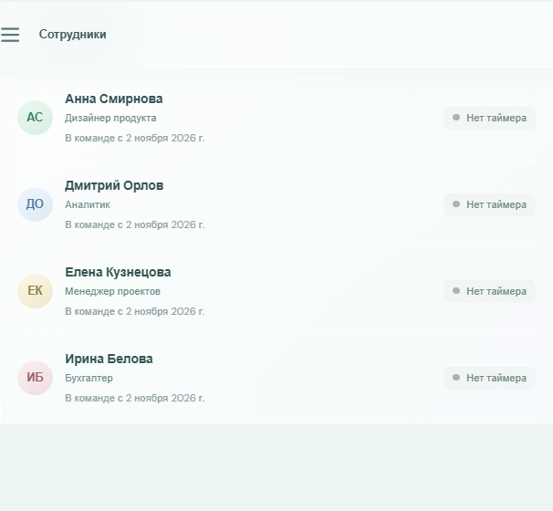

# Смена — учет рабочего времени

Локальное веб-приложение для учета рабочих задач команды. Сотрудники запускают и останавливают таймеры, а приложение хранит записи в SQLite и формирует отчеты по выбранному периоду.

## Возможности

- Добавление сотрудников с проверкой обязательного имени и защитой от дубликатов.
- Запуск одной активной задачи на сотрудника; разные сотрудники могут работать одновременно.
- Остановка таймера с расчетом длительности на сервере.
- Восстановление активных таймеров и завершенных записей после перезапуска.
- Просмотр истории с фильтрами по сотруднику и дате, сортировкой по времени и отображением статуса.
- Отчеты по команде или отдельному сотруднику с задачами и длительностью.
- Адаптивный интерфейс, состояния загрузки и пустых результатов, уведомления об ошибках и успехе.

## Скриншоты

Фрагмент панели сотрудников:



Форма запуска таймера:


## Технологии

- React 19, TypeScript, Vite 7.
- Node.js, Express 5, better-sqlite3, Zod.
- Vitest, Supertest, React Testing Library, jsdom.
- Lucide React для иконок.

Зависимости и точные разрешенные версии фиксируются в `package-lock.json`.

## Архитектура

```text
frontend/
  index.html
  src/
    App.tsx       страницы и взаимодействия приложения
    api.ts        HTTP-клиент
    types.ts      типы данных интерфейса
    utils.ts      форматирование времени и дат
    styles.css    адаптивные стили
backend/src/
  app.ts          REST API, маршруты и обработка ошибок
  database.ts     схема SQLite, индексы и начальные данные
  errors.ts       ошибки предметной области
  index.ts        запуск HTTP-сервера и закрытие базы
  schemas.ts      проверка входных данных через Zod
  services.ts     бизнес-правила и SQL-запросы
  types.ts        типы серверных сущностей
tests/
  backend.test.ts
  frontend.test.tsx
```

Маршруты Express передают проверенные данные сервисам. Сервисы инкапсулируют обращения к SQLite и правила учета. React получает сотрудников, таймеры, историю и отчеты через HTTP API; рабочие данные не сохраняются только в состоянии браузера.

## База данных

При первом запуске сервер создает файл `backend/data/time-tracker.sqlite` и необходимые таблицы. Путь можно изменить через `DATABASE_PATH`.

`employees` содержит `id`, `full_name`, `position`, `created_at`. Имя уникально без учета регистра.

`time_entries` содержит `id`, `employee_id`, `task_description`, `started_at`, nullable `stopped_at`, nullable `duration_seconds` и `created_at`. Внешний ключ связывает запись с сотрудником; foreign keys включены. Проверки запрещают пустое описание и неконсистентные состояния остановки.

Частичный уникальный индекс разрешает не более одной строки с `stopped_at IS NULL` на сотрудника. Он остается последней линией защиты и при параллельных запросах. Есть индексы по времени начала и паре сотрудник/время начала. Схема создается идемпотентно при старте; начальные вымышленные сотрудники добавляются только в пустую таблицу сотрудников.

Даты записываются ISO-строками UTC. В отчетах введенные даты трактуются как календарные дни UTC включительно: технически период представлен полуинтервалом `[начало дня, начало следующего дня)`. Пересекающиеся записи обрезаются по границам периода. Для активной записи конечной точкой расчета служит серверное текущее время. Поэтому отчет показывает только уже прошедшее время активной задачи.

## Установка и запуск

Требуется Node.js 20.19+ или 22.12+ и npm. Для Windows PowerShell ниже используется `npm.cmd`, чтобы не зависеть от Execution Policy для `npm.ps1`.

Установить пакеты:

```powershell
npm.cmd install
```

### Настройка окружения

Настройки необязательны. По умолчанию API слушает только loopback (`127.0.0.1:3001`), а база создается в `backend/data/time-tracker.sqlite`. Vite также доступен только локально.

```powershell
$env:PORT = "3001"
$env:HOST = "127.0.0.1"
$env:DATABASE_PATH = "backend/data/time-tracker.sqlite"
```

Если задается другой каталог базы, сервер создаст его автоматически. Не удаляйте SQLite-файл при перезапуске, если нужно сохранить записи.

### Разработка

Откройте два терминала из корня проекта.

Терминал 1, сервер API:

```powershell
npm.cmd run dev:server
```

Терминал 2, интерфейс Vite:

```powershell
npm.cmd run dev:client
```

Откройте адрес Vite, обычно `http://localhost:5173`. Запросы `/api` проксируются на `http://127.0.0.1:3001`.

### Сборка и запуск

```powershell
npm.cmd run build
npm.cmd start
```

После сборки сервер обслуживает интерфейс и API на `http://127.0.0.1:3001`. Для постоянного хранения данных задайте `DATABASE_PATH` в среде процесса `npm.cmd start`.

## Тесты и проверки

```powershell
npm.cmd test
npm.cmd run typecheck
npm.cmd run lint
npm.cmd run build
```

Backend-тесты используют in-memory SQLite, кроме отдельного сценария перезапуска, который создает временный файл и удаляет его по завершении. Поэтому тесты не используют рабочую базу. Время в сценариях задается внедряемой функцией часов, без ожидания через `sleep`.

Покрыты создание и дубликаты сотрудников, ошибочные идентификаторы, правила запуска/остановки, длительность по серверным timestamp, параллельные сотрудники, сохранение активной и завершенной записи при переоткрытии файла, фильтр сотрудника, пустой отчет, активное время и пересечение полуночной границы.

## REST API

Успешные ответы имеют вид `{ "data": ... }`, ошибки — `{ "error": { "code": ..., "message": ... } }`.

| Метод и путь | Назначение |
| --- | --- |
| `GET /api/health` | Проверка состояния API |
| `GET /api/employees` | Список сотрудников и признак активного таймера |
| `POST /api/employees` | Создание сотрудника |
| `GET /api/time-entries` | История; query: `employeeId`, `date`, `sort=newest\|oldest` |
| `GET /api/time-entries/active` | Активные таймеры |
| `POST /api/time-entries/start` | Запуск таймера |
| `POST /api/time-entries/:id/stop` | Остановка записи |
| `GET /api/reports/summary` | Сводный отчет; query: `startDate`, `endDate`, optional `employeeId` |
| `GET /api/reports/employee` | Разбивка сводного отчета по сотрудникам с теми же query-параметрами |

Примеры для PowerShell:

```powershell
Invoke-RestMethod http://127.0.0.1:3001/api/employees

Invoke-RestMethod -Method Post http://127.0.0.1:3001/api/employees `
  -ContentType "application/json" `
  -Body '{"fullName":"Мария Иванова","position":"Дизайнер продукта"}'

Invoke-RestMethod -Method Post http://127.0.0.1:3001/api/time-entries/start `
  -ContentType "application/json" `
  -Body '{"employeeId":1,"taskDescription":"Подготовить макет отчета"}'

Invoke-RestMethod -Method Post http://127.0.0.1:3001/api/time-entries/1/stop

Invoke-RestMethod "http://127.0.0.1:3001/api/reports/summary?startDate=2026-11-02&endDate=2026-11-02"
```

Если указанный сотрудник или запись отсутствует, API вернет `404`. Пустое имя или описание задачи вернет `400`; попытка запустить второй активный таймер сотруднику вернет `409` с кодом `TIMER_ALREADY_RUNNING`.

## Пример рабочего сценария

1. Добавьте сотрудника на странице «Сотрудники».
2. Откройте «Учет времени», выберите сотрудника и опишите задачу.
3. Нажмите «Запустить таймер». Сервер сохранит время начала в SQLite.
4. Обновите страницу или перезапустите сервер: активная запись загрузится из базы.
5. Остановите таймер. Сервер вычислит секунды между временем начала и остановки.
6. Проверьте запись в истории и сформируйте отчет с нужными датами.

## Использование AI

При разработке использовался GitHub Copilot(Для написания документации.), GPT-6 Luna(Для архитектуры проекта, написание каркаса) И Gemini Argon(Для тестировании). 

Основным запросом для разработки был предоставленный пользователем документ «Build a Complete Employee Working Time Tracking Application» со спецификацией, тестовыми сценариями и условиями приемки. В нем также приведены примеры запросов к AI, в частности:

- «Design a SQLite database schema for an employee time tracking application with persistent active timers.»
- «Implement an Express endpoint that prevents an employee from starting multiple simultaneous timers.»
- «Review the reporting logic for date range overlaps and identify possible double-counting.»
- «Generate automated tests for timer restart persistence and empty reports.»

Это примеры из предоставленного задания; они не выдаются за отдельный журнал запросов. История отдельных внутренних запросов к Copilot в текущем рабочем контексте не предоставлена. Функции подтверждаются приведенными в репозитории тестами и командами проверки, а не неподтвержденными заявлениями об использовании AI.

## Найденные проблемы и исправления

| Проблема | Причина | Исправление и проверка |
| --- | --- | --- |
| Повторный запуск таймера возвращал `500`, а не `409`. | SQLite сообщал конфликт частичного уникального индекса как `UNIQUE constraint failed: time_entries.employee_id`, тогда как обработчик искал имя индекса. | Обработчик сопоставляет фактическую ошибку уникальности с `TIMER_ALREADY_RUNNING`; проверено Supertest-сценарием повторного запуска. |
| Production-сборка не находила HTML entry point. | Vite настроен с корнем `frontend/`, а первоначальный `index.html` находился в корне репозитория. | Entry point размещен в `frontend/index.html`; `npm.cmd run build` проходит. |
| Первый запуск frontend-тестов останавливался до проверки интерфейса. | Vitest компилировал JSX теста в classic mode без привязки `React`. | Добавлен импорт React в тест; обе frontend-проверки проходят. |
| Ранний тест пересечения суток описывал невозможное время окончания до начала. | В fixture часы установки для старта задачи были позже времени остановки. | Fixture приведен к реальному интервалу `23:00–02:00`; проверяется обрезка до двух часов внутри следующего дня и общий итог отчета. |
| Фабрика Express API использовала `await` в аргументе по умолчанию. | Асинхронный импорт в таком выражении не допускался. | База и сервисы теперь передаются при создании приложения; тесты используют изолированные SQLite соединения, а production создает файл явно. Проверено тестами и TypeScript. |
| У первоначальной версии production-зависимости Zod 3 была опубликована рекомендация npm высокой важности. | Выбранная до проверки major-версия попадала в уязвимый диапазон. | Zod обновлен до `4.6.7`; тесты, TypeScript и сборка проходят, `npm audit --omit=dev --audit-level=moderate` сообщает ноль уязвимостей. |
| Некорректный JSON приводил к `500` и stack trace в журнале. | Ошибки Express body-parser не были распознаны централизованным обработчиком. | Для `entity.parse.failed` и `entity.too.large` добавлены безопасные ответы `400`/`413`; проверено Supertest regression-тестом. |
| Фильтр истории с неизвестным `employeeId` возвращал `200` и пустой список. | Сервис истории не проверял наличие сотрудника, в отличие от запуска таймера и отчетов. | Перед запросом истории добавлена проверка сотрудника; Supertest подтверждает `404 EMPLOYEE_NOT_FOUND`. |
| Неизвестный `/api` маршрут возвращал HTML от Express. | Для API не было завершающего JSON 404 handler. | Добавлен fallback с `{ error: { code: "NOT_FOUND", ... } }`; подтверждено Supertest-тестом. |
| Dev API и Vite слушали все сетевые интерфейсы. | Backend не задавал host, а Vite запускался с `--host 0.0.0.0`. | По умолчанию оба слушают loopback; Vite proxy обращается к `127.0.0.1`. Проверено конфигурацией и стартом серверов. |

## Ограничения и дальнейшее развитие

- В приложении нет входа в систему, ролей или разделения данных по владельцам: это единое локальное рабочее пространство. API не защищает записи от другого пользователя, который имеет сетевой доступ к серверу; ID не являются механизмом авторизации. Не публикуйте работающий экземпляр в публичную сеть до внедрения аутентификации и проверок владения. Публичная публикация исходного кода на GitHub безопасна при соблюдении `.gitignore`.
- SQLite-файл локален для экземпляра сервера; для нескольких серверов потребуется централизованная база данных.
- Даты отчетов определяются как UTC-календарные дни.
- История загружается одним запросом, а часть табличных фильтров применяется в браузере; для большой истории понадобятся серверная пагинация и фильтрация.
- Шрифт интерфейса загружается через Google Fonts; при отсутствии сети используются системные резервные шрифты.
- Полный `npm audit` сообщает о 12 умеренных advisory-путях, вызванных одним GHSA для двух версий `minimatch`: `3.1.5` в цепочке установленного ESLint 9.39.5 и `10.2.6` в `@typescript-eslint/typescript-estree` 8.72.1. Проверка актуальных npm metadata показывает, что ESLint 10.14.0 и typescript-estree 8.72.1 также остаются на уязвимой ветке minimatch 10 (`^10.2.6` и `^10.2.2`); исправленная версия `11.0.1` требует major override. `npm audit fix --force` предлагает downgrade TypeScript-ESLint за пределы объявленного диапазона `^8.42.0`. Совместимого безопасного обновления цепочки не найдено, поэтому override/force не применялись. Production-зависимости проходят `npm audit --omit=dev` без уязвимостей.
- Аутентификации и проверки владельца записи нет. IDOR/чужая запись не защищены для нескольких пользователей: любой процесс, которому открыт API, может просматривать общий список и останавливать запись по ID. Loopback bind ограничивает стандартный запуск этой машины, но не заменяет авторизацию. Публичный GitHub source готов после обычного добавления файлов в Git; публичный runtime не готов до внедрения authentication, authorization и проверки миграций/данных.
- Git-репозиторий инициализирован на ветке `master`, но коммитов пока нет: исходные файлы и скриншоты отображаются как untracked. SQLite-файлы находятся в `backend/data/`, который исключен из Git через `.gitignore`; перед первым commit проверьте список `git status --short`.
- Следующие практичные шаги: экспорт CSV/XLSX, часовые пояса, редактирование справочника, авторизация и аудит изменений.
